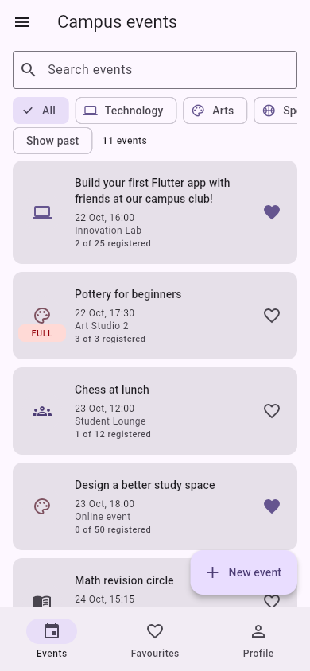
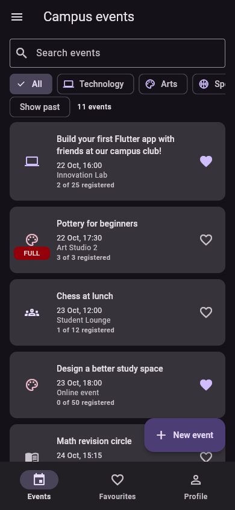
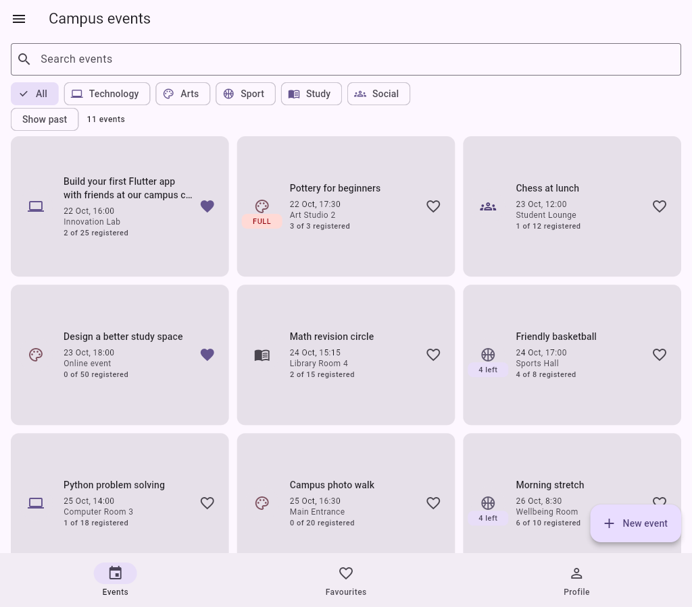

# Campus Events

A beginner-friendly Flutter Lab 1 app. Browse campus events, register with your profile name, and save favourites. All data stays in memory.

## Run the app

Open this folder in VS Code or Android Studio. In its terminal run:

```text
flutter pub get
flutter run -d chrome
```

For Android, start an emulator or connect a phone, then run `flutter run` and select it. Android and web project files are included.

Built with Flutter 3.47.5 and Dart 3.13.4. Use Flutter 3.47 or newer for the included Android project. No database, API, login service, or extra app packages are needed.

## Try these first

1. Open an event and tap Register. The snackbar takes you to Profile.
2. Enter your name and press Enter or Next to save it. Enter a group such as `CS-101` and press Enter or Done.
3. Return to Events, register, and check the Registered tab.
4. Create an event with New event. Try leaving the form with an unsaved change.
5. Change the theme in Profile, widen the window for a grid, or restore the examples using Reset data in the drawer.

The profile identifies people by their trimmed, case-insensitive names. Changing your profile name changes which registrations are recognised as yours; it does not rename old registrations. Example online links are display data. Events last one hour for the countdown, and new registrations close at the start time. Cancelling your own existing registration is still allowed.

## Where to start reading

Read [BEGINNER_GUIDE.md](BEGINNER_GUIDE.md) for the file map, requirement checklist, and all 16 defence exercises. Start with `lib/models/event.dart`, then `lib/screens/app_shell.dart`.

## Screenshots

Phone light theme, 390 by 844:



Phone dark theme, 390 by 844:



Tablet grid, 1024 by 900:



These are captures of the running app in Chrome at phone and tablet viewport sizes.

## Decisions

The shell owns the event list and profile so every tab uses the same data. Tabs receive data and callbacks instead of keeping separate copies. The detail page calls the shell when an event changes, while the form returns an Event so cancelling cannot change the original. The list uses LayoutBuilder because available width determines whether cards belong in a phone list or tablet grid. PopScope compares current form values with the values present when the form opened, and a successful save accepts the current values before popping. ThemeMode lives above MaterialApp so a profile selection changes every screen. With week 9 tools, I would replace the callback plumbing with the state management approach taught then.

## Checks

Verified during the build:

- Flutter analyzer: no issues found.
- Dart formatter: zero changes.
- Release web build: successful.
- Browser checks: registration and cancellation, live counts, profile validation, themes, search and filters, favourites, create/edit/delete, double-save prevention, clean and dirty back navigation, picker cancellation, online and numeric validation, drawer reset, and the 600-pixel grid breakpoint.
- The app rendered with external network access blocked and made no external requests.

Android project files are included; an Android device build and system back gesture have not been verified here.

```text
flutter analyze
dart format --output=none --set-exit-if-changed .
flutter build web --no-web-resources-cdn
git log --oneline
```

The project intentionally has no tests or testing packages, as the lab specifies. The repository includes the actual staged build history with at least 12 meaningful commits. The download includes the hidden `.git` directory; keep it to retain that history.

Initial dependency downloads require internet. The app itself uses no network or storage. For a compiled web version with local rendering resources, use the build command above and serve `build/web` through a local web server.
